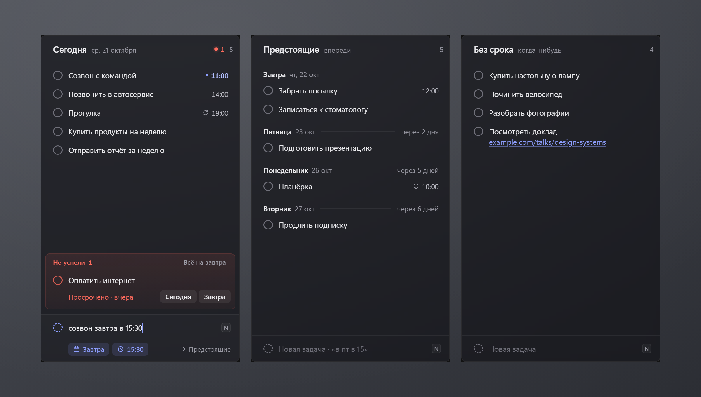

<div align="center">

# Simple Desk Tasks

**Задачи прямо на рабочем столе Windows — всегда на виду, без лишних окон.**

Виджеты «Сегодня», «Предстоящие» и «Без срока», календарь встреч, таймер фокуса со звуками
и мини-плеер. Живут в слое рабочего стола, стартуют вместе с Windows и не мешают работе.


</div>



---

## Возможности

### Задачи
- **Три виджета на втором мониторе** — сегодняшние задачи, ближайшие дни по датам и задачи без срока.
  Просроченные опускаются вниз своего виджета и помечаются.
- **Закреплены на рабочем столе** — не сдвигаются и не меняют размер случайно.
  Переставить можно через трей → «Разрешить перемещение».
- **Alt+N из любого окна** — открывает быстрый ввод. Если в этот момент выделен текст,
  он подставится сам.
- **Даты понимаются из текста** — пишете «созвон завтра в 15:30», задача встаёт на завтра, 15:30.
- **Повторы** — каждый день, по будням, по дням недели, раз в месяц, раз в год.
- **Перенос в один клик** — «на завтра», выбор даты, «всё просроченное — на завтра».
- **Перетаскивание** — между виджетами (меняет срок) и внутри «Без срока» (свой порядок).
- **Ссылки кликабельны**, **уведомления Windows** о задачах со временем,
  **отмена** любого удаления или выполнения — 5 секунд или Ctrl+Z.

### Календарь
- **Встречи из календаря Mail.ru** (CalDAV, только чтение) — колонка справа: месяц с точками
  по дням и повестка на две недели.
- Идущая встреча — с прогрессом «идёт · ещё 25 мин», следующая — с отсчётом и кнопкой
  «Подключиться», если в ней есть ссылка на Толк, Zoom, Телемост, VK Звонки, Teams, Meet или Jazz.
  Календарь праздников «События в этот день» не показывается.
- Напоминание за 5 минут до начала. Обновляется каждые 5 минут.
- Подключается в настройках: почта и
  [пароль для внешних приложений](https://id.mail.ru/security) Mail.ru. Пароль хранится
  в Диспетчере учётных данных Windows.

### Фокус
- **Полоса под задачами** — помодоро 25/5 (каждый четвёртый перерыв длинный), 50/10 и 90/20;
  длительности меняются в настройках или колёсиком над временем.
- Перерыв начинается сам, следующий фокус ждёт клика; конец фазы — звонок и уведомление.
  Оставшееся время видно и в подсказке значка в трее.
- **18 звуков** в трёх группах. Дождь: слабый, обычный, ливень, с ветром, гроза, по крыше.
  Природа: волны, камин, ветер, ручей, ночь, лес. Шум: белый, розовый, коричневый,
  вентилятор, поезд, самолёт.
- **Самолёт** — салон 737 в полёте: время от времени «дин-дон» табло, а раз в 15–25 минут
  трёхтоновый сигнал и объявление экипажа.
- Дождь, природа, вентилятор, поезд и самолёт — **настоящие записи** (CC0, с Freesound, авторы — в
  [tools/sounds/CREDITS.md](tools/sounds/CREDITS.md)). Каждая скачивается при первом выборе,
  около 1 МБ, и дальше лежит на диске. Без интернета звучит синтезированная версия. Белый,
  розовый и коричневый шум синтезируются всегда.
- **Смесь из двух звуков** — каждому своя громкость колёсиком над плиткой.
- **Статистика** — клик по «сегодня N мин»: семь дней столбиками, серия дней и лучший день.

### Плеер
- Что играет в Spotify (или в другом плеере Windows): обложка, трек, назад / пауза / вперёд,
  перемешивание и повтор, перемотка по полосе, громкость самого плеера (как в микшере Windows,
  колёсиком над карточкой тоже). Виджет появляется, только когда что-то играет.

### Остальное
- **Настройки** (трей → «Настройки…») — календарь, длительности фокуса, папка бэкапа,
  автозапуск, обновления.
- **Обновляется само** — новые версии приходят из релизов на GitHub, подпись проверяется,
  ставится, когда вы ничем не заняты в приложении. Если новая версия не запустилась,
  при следующем старте вернётся прежняя.
- **Лёгкое** — один exe на системном WebView2, без облака: задачи хранятся локально.

## Как писать даты

| Пишете                          | Получаете                         |
| ------------------------------- | --------------------------------- |
| `купить молоко сегодня`         | сегодня                           |
| `созвон завтра в 15:30`         | завтра, 15:30                     |
| `отчёт послезавтра утром`       | послезавтра, 09:00                |
| `встреча в пт в 10`             | ближайшая пятница, 10:00          |
| `сдать документы 25.10`         | 25 октября                        |
| `продлить домен через 2 недели` | через 14 дней                     |
| `планёрка каждый пн в 10`       | по понедельникам в 10:00          |
| `зарядка по будням вечером`     | пн–пт, 19:00                      |
| `оплата каждый месяц`           | каждый месяц в этот же день       |

Распознанная дата подсвечивается прямо в поле ввода, текст задачи остаётся чистым.

## Клавиши

| Клавиша       | Где                 | Что делает                                   |
| ------------- | ------------------- | -------------------------------------------- |
| `Alt+N`       | везде               | быстрая задача (с выделенным текстом, если есть) |
| `N`           | в виджете           | фокус на поле новой задачи                   |
| `Enter`       | поле ввода          | добавить                                     |
| `Shift+Enter` | быстрая задача      | добавить и оставить окно открытым            |
| `Esc`         | ввод, редактирование | отменить                                     |
| `Ctrl+Z`      | в виджете           | вернуть последнее действие                   |

Если Alt+N занят другой программой, используется `Ctrl+Alt+N` или `Alt+Shift+N` —
актуальная комбинация видна в меню трея.

## Установка

**Готовая версия:** скачайте `DeskTasks.exe` из
[последнего релиза](https://github.com/lintery/simple-desk-tasks/releases/latest),
положите, например, в `%LOCALAPPDATA%\Programs\DeskTasks` и запустите. Автозапуск
с Windows приложение включит само, дальше обновляется само.

**Из исходников:** нужны [Rust](https://rustup.rs) 1.87+ и WebView2 (в Windows 10/11 уже есть).

```powershell
pwsh -File tools/install.ps1
```

Скрипт собирает release, кладёт `DeskTasks.exe` в `%LOCALAPPDATA%\Programs\DeskTasks`,
создаёт ярлык «Задачи» в меню Пуск и запускает приложение.

**Данные:** `%APPDATA%\app.desktasks.widgets\` — `tasks.json` (задачи), `settings.json`,
`focus.json` — обычный JSON.

**Бэкап:** после каждого изменения копия уходит в папку из настроек (по умолчанию
`D:\backups\simple-desk-tasks`) как `tasks-ГГГГ-ММ-ДД.json`: один файл на день с последним
состоянием за этот день, хранятся последние 30 дней.

- Если снимок дня не совпадает с тем, с чем стартовало приложение, первое изменение
  его не затирает: старый откладывается в `tasks-ГГГГ-ММ-ДД.before-ЧЧММСС.json`.
- Если `tasks.json` пропал, приложение при старте само поднимет задачи из самого
  свежего снимка.
- Пока бэкап не читается, приложение ждёт в режиме «только чтение», а не стартует пустым.
- Если запись не удалась, придёт уведомление Windows.

## Разработка

```powershell
npm test                                            # логика интерфейса: даты, повторы, группировка
cargo test --manifest-path src-tauri/Cargo.toml     # таймер, бэкап, календарь, плеер, обновления
```

Интерфейс можно смотреть в браузере без сборки Rust: запустите статический сервер в корне
репозитория и откройте `tools/dev/showcase-widget.html?w=today` (или `upcoming`, `nodate`,
`focus`, `player`, `calendar`, `settings`) — там подменён API Tauri и выдуманы данные.
Картинка для README: `pwsh -File tools/dev/screenshot.ps1`. Звуки фокуса можно послушать
на `tools/dev/sounds.html`.

**Релиз:** поднимите версию в `src-tauri/Cargo.toml`, закоммитьте и запустите
`pwsh -File tools/release.ps1` — он соберёт exe, подпишет его ключом из
`%USERPROFILE%\.simple-desk-tasks\updater.key` и после подтверждения опубликует релиз
на GitHub. Установленные копии подхватят его сами.

## Устройство

```
src-tauri/src/
  main.rs        окна, трей, горячая клавиша, перетаскивание между окнами, окно настроек
  layout.rs      раскладка по мониторам, закрепление
  desktop.rs     слой рабочего стола, автозапуск, ссылки, выбор папки
  settings.rs    настройки (settings.json)
  store.rs       хранилище задач (атомарная запись, защита от порчи файла)
  backup.rs      ежедневные снимки задач в папку бэкапа
  focus.rs       таймер фокуса: фазы, история, звонки, уведомления, время в трее
  media.rs       что играет: медиасессии Windows и громкость плеера
  calendar.rs    встречи Mail.ru по CalDAV, напоминания
  ical.rs        разбор iCalendar: часовые пояса, повторы, ссылки на созвоны
  updater.rs     обновления из релизов GitHub с проверкой подписи
  sounds.rs      записи звуков фокуса: скачивание, проверка, хранение на диске
  net.rs         HTTPS-запросы для обновлений и звуков
  selection.rs   захват выделенного текста для Alt+N с восстановлением буфера обмена
  notify.rs      уведомления о задачах
  backdrop.rs    обои под стеклом виджетов
ui/
  index.html, app.js, style.css   виджет задач
  focus.*, player.*, calendar.*    фокус, плеер, календарь
  settings.*                       окно настроек
  quick.*                          окно быстрой задачи
  lib/nlp.js                       разбор дат на русском
  lib/model.js                     группировка, просрочка, повторы
  lib/sounds.js                    звуки для фокуса (Web Audio: записи и синтез)
design/          макеты вариантов дизайна (выбран «Графит»)
tools/           установка, релиз, подпись обновлений, иконка, dev-страницы
tests/           тесты логики интерфейса
```
